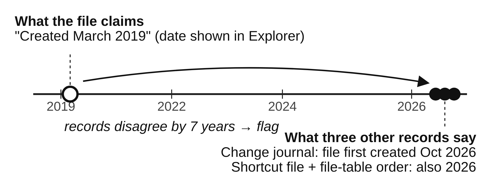

::: abstract
A person hiding evidence on a computer can change the dates on a file, rename a photo to look like a program, or tuck a file inside another one, each in seconds. But a drive records the same facts in several independent places, and a cover-up rarely keeps all of them in agreement. This paper proposes the Artifact Disagreement Scorer (ADS), a tool that checks a drive's records against each other and points an examiner to the files where they disagree. It has two families of checks: eleven rules that compare the dates Windows keeps in different places, and eight first-look questions that compare what a file claims to be with what it holds. It combines the results into one ranked list with a plain-language reason for every flag. The evaluation is a proof of function on the two forensic images from this course, using my own EnCase and FTK examinations as the answer key. On the first image, a development case, ADS listed all seven evidence files I had found by hand among 2,246 files, six of them in its top ten. The second image is a held-out test: the checks were frozen before it was examined. On it, ADS listed seven of the sixteen evidence files among 4,818 files, five in its top ten, and showed that nearly every visible date on the drive had been set to one moment.
:::

::: keywords
Digital forensics, anti-forensics, timestamp manipulation, NTFS, FAT, tool validation, triage
:::

# Introduction

Investigations depend on trusting what a drive says about its files: when each was made, what it is, and where it sits. Each of these is easy to fake. The dates Windows shows can be rewritten by any program with ordinary rights, a technique called *timestomping* [4]. A photo can be renamed to look like a system program, and a file can be hidden inside another one or after its end.

A drive, however, records the same facts in more than one place, written by different parts of the system for different reasons. The NTFS file system keeps a second, harder-to-reach copy of every file's dates, and a journal of changes. Windows writes shortcut (LNK) files when a document is opened, Prefetch files when a program runs, and event logs for logons and clock changes. A file's name says what it is, and so do its first bytes. Someone covering their tracks may change one of these, but keeping all of them consistent is much harder, so a cover-up tends to leave records that *disagree* (Fig. 1).

{width=column}

Commercial suites such as EnCase and FTK display these records but leave the examiner to notice that two of them disagree. Specialized tools automate single checks, and each one alone is weak: normal activity also produces odd dates, and a single filter returns hundreds of files. This paper asks: *does combining many independent disagreement checks point an examiner to planted evidence better than any single check?* Section II reviews prior work, Section III describes the tool, and Section IV gives the plan to test it on the two course images.

# Background and Related Work

**Terms.** NTFS stores four dates for each file in its *Master File Table* (MFT): Created, Modified, Accessed, and Entry-changed (when the file's record last changed). It stores them twice. The *Standard Information* copy (SI) is what Explorer shows and what programs can set; the *File Name* copy (FN) is kept by the file system and cannot be set through the normal programming interface. This paper writes SI-C for the SI created date, FN-C for the FN created date, and so on.

**Single checks.** Early work set out rules that NTFS dates obey in normal use [3] and noted that SI dates earlier than FN dates [5], or SI dates with an all-zero fraction of a second [6], suggest tampering. Magnet AXIOM reports SI and FN mismatches [10], which is one check (R6 below) on its own; timeline tools such as Plaso merge records by time without testing whether they agree. Recent work studies NTFS dates in more depth [11], [12]. Willassen [7] and Casey [8] showed that the order in which records are allocated on disk, like layers of rock, can reveal a file that claims to be older than its neighbors. File-signature analysis, which compares a file's name with its first bytes, is a standard single check in EnCase and FTK.

**Combining records.** Palmbach and Breitinger [1] are the closest work. They showed that the change journal, LNK files, Prefetch, and event logs all carry traces of timestamp changes, concluded that none is reliable alone, and proposed five rules across them. They recommend combining sources but did not measure whether combining helps, and their test used four files on an unused system. Vanini, Hargreaves, and Breitinger [2] proposed seven factors for rating how hard a record is to tamper with, but they rate the record type, not whether a given drive shows tampering.

**The gap.** No prior work measures, on images an examiner actually receives, whether combining cross-record checks reaches planted evidence with less effort than the best single check.

# Proposed Solution

## Overview and Design Goals

The Artifact Disagreement Scorer (ADS) opens a raw image of a FAT or NTFS drive, lines up its independent records file by file, applies two families of checks, and combines the results into one ranked list (Fig. 2). Four goals shape the design:

1. **Combine, do not trust one check.** A file rises when several independent checks disagree about it, so normal noise in one record does not put it at the top.
2. **Treat a missing record as a clue.** Deleting a record is often easier than faking one [1]. ADS reports cleared or missing records instead of silently skipping the rules that need them.
3. **Explain every flag.** Every score breaks down into the checks that fired and the values they compared, in plain language, so an examiner can state and defend why a file was flagged.
4. **Usable by non-specialists.** Findings go to investigators, lawyers, and commanders. ADS runs from a point-and-click window, never changes the image, and writes one web page that explains each flag in plain sentences.

{width=2.9in}

**Scope.** Raw images of FAT and NTFS drives; for the date rules, changes made from inside a running Windows system. Changes made by editing the raw disk offline bypass the journals and are out of scope.

## Windows Date Checks

Table I lists the five records the date rules compare. Each is written by a different part of Windows, which is what makes their agreement meaningful.

Table: Records used by the date checks

| Record | Written by | What ADS uses | Linked by |
|---|---|---|---|
| MFT (SI and FN) | File system | Eight dates, record number | File ID |
| Change journal ($J) | File system | Create and date-change entries | File ID |
| Shortcut (LNK) files | Windows shell | Own dates; copy of target's dates | Path |
| Prefetch | Windows | Program name, last 8 run times | Path, time |
| Event logs | Event Log service | Logons, log clearing, clock changes | Time |

Journal entries carry the file ID (MFT record number plus a reuse counter), so those links are exact; shortcuts and Prefetch name files by path; event logs are linked by time. ADS reads the MFT straight from an NTFS image, or all five records from the output of Eric Zimmerman's parsers [9]. Each rule gives one of three answers: *consistent*, *violated*, or *cannot check* when a record is missing (Table II).

Table: Date rules (C = created, A = accessed, E = entry changed)

| ID | The rule checks that... | From |
|---|---|---|
| R1 | SI-E is not earlier than the journal's last date-change entry | [1] |
| R2 | A shortcut's SI-E matches its target's SI-E | [1] |
| R3 | A shortcut was not created before its target | [1] |
| R4 | A shortcut's SI-A is not after its target's SI-A | [1] |
| R5 | SI-C and SI-M fall inside a logged-on session | [1] |
| R6 | SI-C is not earlier than FN-C | [5] |
| R7 | SI dates do not have an all-zero fraction of a second | [6] |
| R8 | The journal's file-created entry agrees with SI-C | New |
| R9 | The target date copied inside a shortcut agrees with SI-C | New |
| R10 | A date change does not line up with an unusual program run | [1] ext. |
| R11 | SI-C is plausible next to neighboring MFT records | [7], [8] |

R8 and R9 are the main new rules. A journal's file-created entry is not touched by a later change to the visible dates, so one dated well after the claimed creation date is strong evidence of backdating. Every shortcut keeps a copy of its target's dates, so a creation date that has since moved is suspicious even when the shortcut's own dates look normal. Five warnings keep missing records visible: **S1** an event log was cleared, **S2** the change journal was deleted or starts late, **S3** event logs have numbering gaps, **S4** the system clock was changed, and **S5** files clearly opened have no shortcut or programs that ran have no Prefetch file. They mark every "consistent" answer that rests on a damaged record as low-confidence.

## First-Look Questions

Many drives an examiner receives are not Windows system drives: a USB stick is often FAT, and a data drive may hold another system's files. The same idea applies to what any drive records about a file's content. Table III lists eight questions ADS asks of every file on a FAT or NTFS image.

Table: First-look questions

| ID | Where two records disagree |
|---|---|
| C1 | The name says one type; the first bytes say another |
| C2 | The file continues after its format says it ends |
| C3 | The file is locked with a password |
| C4 | A password is written out in plain words inside a file |
| C5 | The file is unlike everything else in its folder |
| C6 | The folder's documentation names its neighbors but not it |
| C7 | An archive holds locked or personal files |
| F1 | Written at a different time from the bulk copy around it |

## Scoring

Both families are scored the same way. The score rewards agreement among independent checks and discounts checks that fire often:

$$ D(f) = \frac{\sum_r w_r \, v_r(f)}{\sum_r w_r} $$

Here v_r(f) is 1 if check r fires for file f and 0 if not; checks that cannot be run are left out of both sums, and the number that could be run is reported beside D(f). Each weight w_r is ln(1/p_r), where p_r is how often check r fires on the image being examined, so a check that fires on 2% of its files counts for more than one that fires on 20%. For the date rules, w_r is also multiplied by a factor from 1 to 3 built from the seven tamper-resistance factors of [2], so records a user cannot easily reach (the journal, the FN dates) count for more than records a user can edit or delete (shortcuts, Prefetch). [2] scores the SI and FN dates itself; for the other records I applied its categories, and those scores are provisional. To my knowledge this is the first use of [2] as a numeric input to detection.

A weighted sum was chosen over a trained classifier because there is no labeled training data and because a sum keeps every flag explainable. Files are ranked by D(f); flagged files whose date evidence falls within five minutes of each other are grouped with any program runs and warnings in that window, turning a list of files into a candidate event.

## Implementation

ADS is written in Python 3 with only the standard library, so it runs on any computer with Python installed. It reads FAT and NTFS images itself, read-only. Both readers were checked against The Sleuth Kit: the FAT reader matched it byte for byte on all 4,923 files of the Project 1 image, and the NTFS reader matched it on every file of a test image built to include fragmented, hard-linked, hidden and deleted files, and on 3,605 files of a larger partitioned image. Every input is hashed with SHA-256. Each check is a separate function that records the values it compared, and the same code produces each single-check baseline ("C1 only," "R6 only") from identical inputs. The pipeline passes 59 automated tests.

# Evaluation Plan

The evaluation is a proof of function: does ADS point an examiner to what a careful manual examination found, and with how much effort, on images I did not build?

## Research Questions

- **RQ1. Does it point to the evidence?** What share of the evidence files found by hand does ADS list, and how far down?
- **RQ2. Better together?** Does the combined ranking reach more evidence for the same number of files reviewed than any single check alone?
- **RQ3. Does it hold on unseen data?** Do the results hold on an image the checks were not tuned on?
- **RQ4. Is it understandable?** Can the report alone explain each flag to a non-specialist, and how long does a run take?

## The Two Course Images

Table IV summarizes the two images. Both were examined by hand before ADS was run on them, so each has an answer key.

Table: The two course images

| | Project 1 | Project 2 |
|---|---|---|
| Drive | FAT16 external drive | NTFS volume of copied Linux files |
| By hand | EnCase | FTK |
| Answer key | 7 evidence, 2 decoys | 16 evidence, 3 decoys |
| Role | Development | Held-out test |

**Answer keys.** Each key lists the files that answered a case question (the evidence) and the files planted to mislead that I had to rule out (decoys), with how each was found by hand. A file matches if its path ends with the key's path. Files ADS lists that are not in a key are not necessarily false alarms: the key is one examiner's findings.

**Freezing the checks.** I wrote the eight first-look questions after examining Project 1, so its result is a demonstration, not a test. They were committed on October 20, before Project 2 was examined, and an automated test fails if they change. Project 2 is therefore a held-out test. Support for reading NTFS was added later, but it only reads the drive and changes no check. Any later change to a check will be reported separately as post hoc.

**Date checks on real data.** Project 2's image is NTFS, so the date rules that need only the MFT (R6, R7, R11) run on it directly. It holds a Linux file system with no shortcuts, Prefetch, or Windows event logs, so the other rules cannot be checked there; they are verified on synthetic test cases. There is no answer key for timestamp tampering on this image, so this part reports what the date rules flag and whether those files appear in the answer key.

## Measures

For each project: evidence files listed; the rank of each; how many are in the top ten; the *review depth*, the number of files an examiner must read to reach every evidence file ADS found, and how many of those are not in the key; and decoys listed (RQ1, RQ3). For RQ2, each check alone flags a set of files in no order; ADS gets the same budget, its top files, and the evidence each finds is compared. For RQ4, I check that every flag in the top twenty is explained by the report alone, and record run time.

**Early result (Project 1, development case).** ADS listed 76 of 2,246 files. All 7 evidence files were among them, 6 in the top ten, and all within the top 16, with 7 files outside the key above the last one. Both decoys were listed. No single check caught more than 4 of the 7. The broad checks lost clearly to the combination (F1 alone caught 4 in the 12 files it flags, ADS's top 12 held 6), but the two most precise checks, which flag one file each, beat it at that budget because ADS's top file was a decoy.

**Held-out result (Project 2).** With the checks frozen, ADS listed 164 of 4,818 files. 7 of the 16 evidence files were among them, 5 in the top ten, and all within the top 15, with 7 files outside the key above the last one. One of the 3 decoys was listed. ADS found less than half of the evidence, and as on Project 1 the narrow checks beat it at budgets of one to three files, so the first two success criteria below were not met. Every top-twenty flag carries a plain-language explanation, and each of the nine misses is explained by what ADS does not read, such as document metadata, page content, or a password written as "pswd =". The date rules R6 and R7 fired on almost every file: nearly every visible date had been set to 2 Oct 2011 11:57:01, while the FN dates show the files were written in two batches six years apart. Because those rules fire everywhere, their weight fell to nearly zero and no single file was flagged.

## Success Criteria

On Project 2: (1) ADS lists at least half of the evidence files; (2) for every single check, ADS's top files hold at least as many evidence files as that check flags with the same budget; (3) every top-twenty flag is explained by the report alone; and (4) every missed evidence file is explained by what ADS does and does not examine. A result that falls short is reported as found.

## Threats to Validity

Two images are a small sample. Each answer key is one examiner's findings and may be incomplete. Both images are teaching cases with planted evidence, not real adversaries. I wrote the checks, which is why Project 1 counts only as development and Project 2 was held out. The Windows-only date rules are exercised on real data only through the MFT; the rules that need shortcuts, Prefetch, and event logs are tested on synthetic cases only.

## Status and Schedule

The tool, both readers, the answer keys, and the runs on both projects (October 26) are done; the Project 1 result reproduced exactly on a second computer. Project 2's full results, including the date checks, are reported in Section V of the final paper (by Dec 6).

# References

::: references
[1] D. Palmbach and F. Breitinger, "Artifacts for detecting timestamp manipulation in NTFS on Windows and their reliability," *Forensic Sci. Int.: Digit. Investig.*, vol. 32, 300920, 2020.

[2] C. Vanini, C. Hargreaves, and F. Breitinger, "Evaluating tamper resistance of digital forensic artifacts during event reconstruction," arXiv:2412.12814, 2024.

[3] K.-P. Chow, F. Y. Law, M. Y. Kwan, and P. K. Lai, "The rules of time on NTFS file system," in *Proc. 2nd Int. Workshop Systematic Approaches to Digital Forensic Engineering (SADFE)*, 2007, pp. 71–85.

[4] MITRE, "Indicator Removal, Technique T1070," MITRE ATT&CK. [Online]. Available: https://attack.mitre.org/techniques/T1070/

[5] X. Ding and H. Zou, "Reliable time based forensics in NTFS," School of Software, Shanghai Jiao Tong University, 2010.

[6] A. Gungor, "Date forgery analysis and timestamp resolution," Meridian Discovery, 2014.

[7] S. Y. Willassen, "Finding evidence of antedating in digital investigations," in *Proc. 3rd Int. Conf. Availability, Reliability and Security (ARES)*, 2008, pp. 26–32.

[8] E. Casey, "Digital stratigraphy: Contextual analysis of file system traces in forensic science," *J. Forensic Sci.*, vol. 63, no. 5, pp. 1383–1391, 2018.

[9] E. Zimmerman, "Eric Zimmerman's tools." [Online]. Available: https://ericzimmerman.github.io/

[10] R. Andrade, "Expose evidence of timestomping with the NTFS timestamp mismatch artifact," Magnet Forensics, 2020.

[11] J. Oh, S. Lee, and H. Hwang, "Forensic detection of timestamp manipulation for digital forensic investigation," *IEEE Access*, 2024.

[12] M. Galhuber and R. Luh, "Time for truth: Forensic analysis of NTFS timestamps," in *Proc. 16th Int. Conf. Availability, Reliability and Security (ARES)*, 2021, pp. 1–10.
:::
